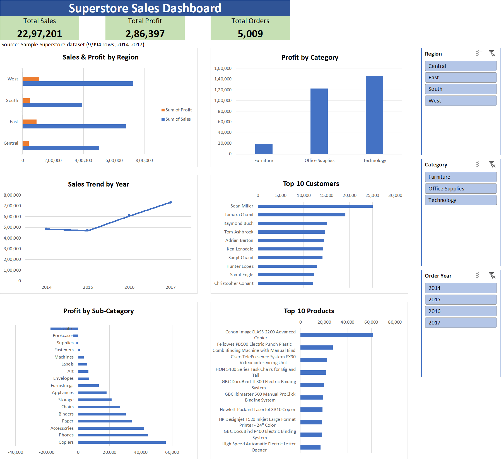

# Superstore Sales Analysis (Excel)

An Excel project where I analyse sales data from a retail store to find which regions, categories and products drive sales, and where the business loses money.

This is my first data analytics project. I am learning Excel, SQL and Power BI as I prepare for a data analyst role.

## Dataset

Sample Superstore dataset, a public retail dataset available on Kaggle.

- 9,994 rows and 21 columns
- Orders from 2014 to 2017
- Columns include Order Date, Region, Category, Sub-Category, Customer Name, Product Name, Sales, Quantity, Discount and Profit
- No blank cells and no duplicate rows

## Business questions

1. How much did the store sell and earn overall?
2. Which regions and categories perform best?
3. Which sub-categories lose money?
4. Who are the top customers and products?
5. How have sales changed over the years?

## Process

1. **Prepared the data.** Saved the CSV as an Excel file and turned it into a Table. Checked dates, blank cells, duplicate rows and extra spaces, and added helper columns (Order Year, Order Month, Result).
2. **Used formulas.** Used SUM, COUNTIF, SUMIF, IF and XLOOKUP on the `Analysis` sheet to answer basic questions such as sales by region and profit by category.
3. **Built Pivot Tables.** On the `Pivots` sheet: Sales and Profit by Region, Category, Sub-Category and Year, plus Top 10 Customers and Top 10 Products.
4. **Built the dashboard.** On the `Dashboard` sheet: 3 KPI boxes, 6 charts and Slicers for Region, Category and Order Year.

## Key insights

- **Overall:** Total sales are 2,297,201 and total profit is 286,397, a profit margin of 12.47%. There are 5,009 unique orders.
- **Regions:** West has the highest sales (725,458) and the highest profit. Central has the lowest margin, about 7.9%.
- **Categories:** Furniture has high sales (741,999) but only 18,451 in profit, a margin of about 2.5%. Technology and Office Supplies have margins of about 17%.
- **Loss-making sub-categories:** Tables (about -17,725), Bookcases (about -3,473) and Supplies (about -1,189) lose money.
- **Customers and products:** Sean Miller is the top customer (about 25,043 in sales). The Canon imageCLASS 2200 Advanced Copier is the top product (about 61,600 in sales).
- **Trend:** Sales grew from 484,247 in 2014 to 733,215 in 2017, with a small dip in 2015.

## Limitations

- The three KPI boxes are formulas on the full table, so they do not change when a Slicer is used. The charts do.

## Next steps

- Repeat the analysis in SQL.
- Rebuild the dashboard in Power BI, with KPI cards that react to filters.

## Files

| File | What it is |
|------|------------|
| `superstore_excel_analysis.xlsx` | The Excel workbook. Sheets: Data, Analysis, Pivots, Dashboard |
| `dashboard.png` | Picture of the final dashboard |
| `notes.md` | My learning notes while building the project |

## Tools

Microsoft Excel: Tables, formulas, Pivot Tables, Pivot Charts and Slicers.
